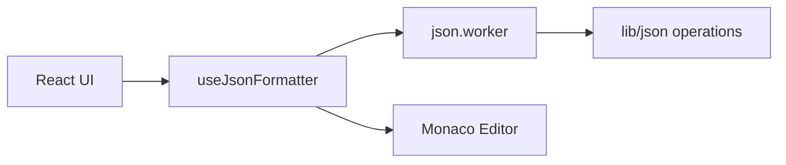

# Architecture

Browser-only JSON toolkit: React 19 + Vite, Monaco for editing, a Web Worker for CPU-bound parse/format work.

## High-level flow



1. User edits JSON in **Input** (`InputPanel` → `JsonEditor`).
2. `useJsonFormatter` debounces **validate** and updates tab status/stats.
3. Actions post messages to **json.worker**, which calls pure functions in **lib/json**.
4. Results update tab `output`, `stats`, and Monaco error markers via `useEditorErrors`.

## Directory structure

```
src/
  app/App.tsx             # mounts FormatterView
  main.tsx
  features/formatter/
    ui/                   # FormatterView, sidebar, editors (AsriUI)
    hooks/
    model/                # types.ts, reducer.ts
    lib/json/             # pure JSON operations
    worker/json.worker.ts
    constants/
    utils/
    index.ts              # public exports
  shared/
    asriui/               # subpath re-exports + TS shims
    providers/            # AsriUIProvider + theme
```

## JSON operations (lib/json)

| Operation | Behavior |
|-----------|----------|
| `formatJson` | Parse → optional recursive key sort → pretty-print with indent/tab |
| `minifyJson` | Parse → `JSON.stringify` compact |
| `validateJson` | Parse only; returns stats |
| `repairJson` | Parse or heuristic repair (trailing commas, quotes, `undefined`/`NaN`) |
| `sortKeysJson` | Parse → sort all object keys → pretty-print |
| `escapeJsonString` | `JSON.stringify` on raw text |
| `unescapeJsonString` | Parse JSON string value back to plain text |

Stats (lines, chars, keys, elements, byte size) are computed once per successful parse.

## State model

- **Tabs:** array in `useReducer(tabReducer)`; each tab holds `input`, `output`, `status`, `stats`, `processing`.
- **Settings:** global `EditorSettings` (indent, Monaco theme, line numbers, wrap, sort-on-format).
- **Active tab:** `activeTabId` in React state; closing tabs falls back to neighbor.

Worker requests are correlated by incrementing `id`; promises in `useJsonWorker` resolve on matching responses.

## Worker boundary

Keeps `JSON.parse` / stringify off the main thread for large payloads. The worker imports the same `lib/json` modules as the main bundle would, avoiding duplicated business rules.

## Theming

- **App chrome:** CSS variables + Tailwind (`dark` class).
- **Editor:** Monaco custom themes mapped from `EditorTheme` enum.

## Extension points

- New JSON tool: add function in `lib/json/operations.ts`, case in worker + `useJsonWorker`, button in `ActionsCard`.
- New setting: extend `EditorSettings`, `settingsReducer`, and `SettingsCard`.

## Build

- Vite with `@/` alias (`vite.config.ts`, `tsconfig.app.json`)
- Worker format: ES modules (`worker.format: 'es'`)
